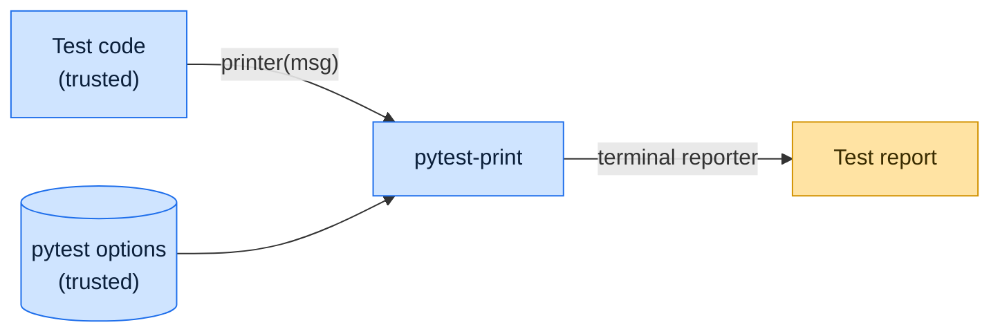

# Threat model

This model says what pytest-print trusts, where untrusted input enters, and which guarantees hold at each boundary, so a
report can be classified as a vulnerability or a bug. [SECURITY.md](SECURITY.md) covers reporting; if the two disagree,
SECURITY.md wins and we fix this file.

## How pytest-print works

pytest-print provides fixtures (`printer`, `printer_session`, `pretty_printer`, `create_pretty_printer`) that write
lines through pytest's terminal reporter while tests run, when `--print` or `-v` is given. It reads nothing from disk or
the network and runs no code of its own beyond formatting the text it is given.

## Compared with similar tools

We drew the boundary where comparable projects in other ecosystems draw theirs. The shared rule, stated by the
[Node.js threat model](https://github.com/nodejs/node/blob/main/SECURITY.md#the-nodejs-threat-model), is that a report
which first needs a trusted element compromised is out of scope; the first triage question, as
[DOMPurify](https://github.com/cure53/DOMPurify/blob/main/SECURITY.md#what-we-consider-a-vulnerability) puts it, is what
the attacker controls.

| Project                                                        | Language   | Where it draws the line                                                                                                             |
| -------------------------------------------------------------- | ---------- | ----------------------------------------------------------------------------------------------------------------------------------- |
| [Vitest](https://github.com/vitest-dev/vitest/security/policy) | JavaScript | Trusts the developer, the config file, plugins and every project file; only reports that need no trusted element compromised count. |
| [Jest](https://github.com/jestjs/jest/security/policy)         | JavaScript | Test runner; private reports with an escalation path, and no separate threat model.                                                 |
| [Mocha](https://github.com/mochajs/mocha/security/policy)      | JavaScript | Test runner; reports through Tidelift, with no further scope.                                                                       |

## Trusted

An attacker who controls any of these already has what pytest-print could give them:

- The tests and the text they pass to the fixtures.
- pytest, its configuration and its terminal reporter.

## Untrusted inputs

| Input           | Comes from                                           | What pytest-print guarantees                              |
| --------------- | ---------------------------------------------------- | --------------------------------------------------------- |
| None of its own | pytest-print takes input only from trusted test code | Prints only when enabled, only through pytest's reporter. |

## Threats and controls

| STRIDE                 | Threat                                                                | Control                                    |
| ---------------------- | --------------------------------------------------------------------- | ------------------------------------------ |
| Information disclosure | Debug lines with sensitive data appear when printing was not enabled. | Output is gated on `--print` or verbosity. |

## Release chain

Releases run on the shared [tox-dev/github-workflows](https://github.com/tox-dev/github-workflows) pipeline. A release
App, not a person, pushes the release commit and tag; the build installs its tools from a hash-checked `pylock.toml`
resolved with a seven-day upload cooldown by default; PyPI receives the files through
[trusted publishing](https://docs.pypi.org/trusted-publishers/) with attestations, and the GitHub Release is immutable.
Every workflow pins third-party actions to a commit SHA.

## Vulnerability or bug

| Report                                   | Verdict             | Why                                     |
| ---------------------------------------- | ------------------- | --------------------------------------- |
| A test prints a token with `printer`     | Not a vulnerability | The test chose to print it.             |
| pytest-print writes lines to a file      | Vulnerability       | It must only use the terminal reporter. |
| Indentation is wrong in `pretty_printer` | Bug                 | Formatting only.                        |

## Severity

- **Medium:** pytest-print writes anywhere other than pytest's terminal reporter.
- **Low:** pytest-print prints while neither `--print` nor `-v` is given.

## Accepted risks

- None beyond what the tests print.

## Keeping this current

Revisit this model when pytest-print gains a new input source, network access, a new way to run code, or a new place it
writes to, and whenever an advisory is published.
